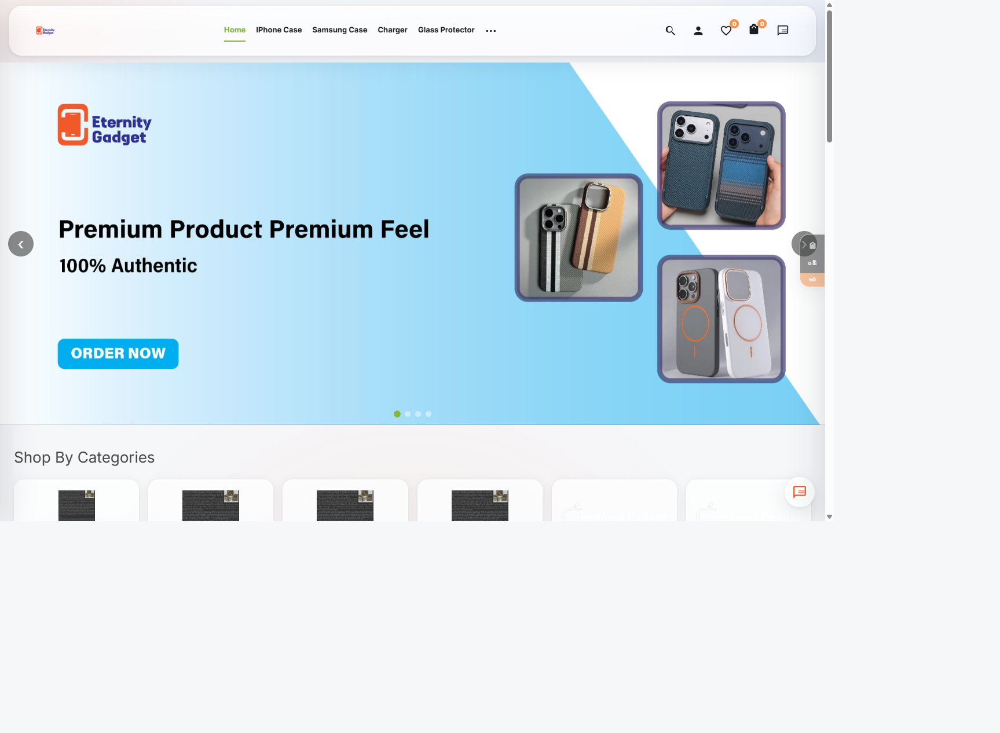
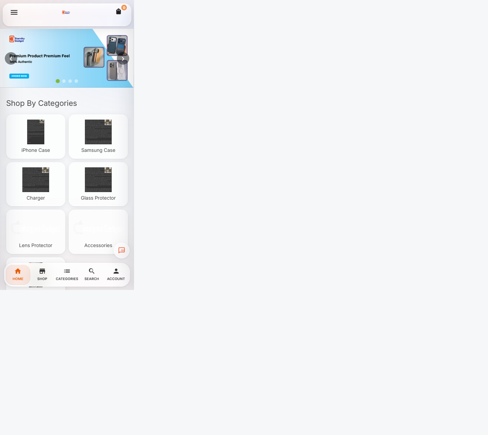
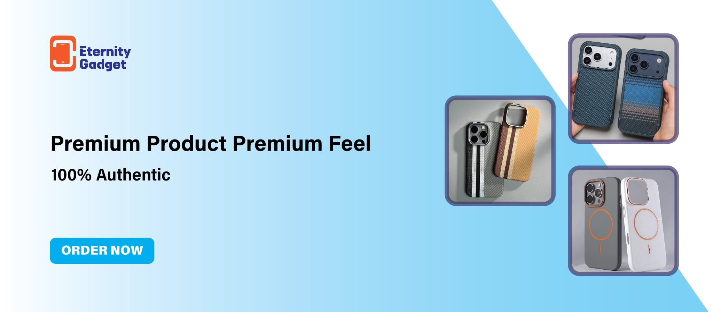

# Eternity Gadget

Premium phone cases, chargers, glass protectors and tech accessories for Bangladesh.

**Live site:** [eternitygadget.com](https://eternitygadget.com)

**Made by Tahsan Islam.** Copyright (c) Tahsan Islam.

Laravel storefront with Filament-style admin tooling, product options, wishlist, cart, checkout, order tracking, reward points, and mobile-first glass UI.

---

## Screenshots (from local)

### Desktop homepage


### Mobile homepage


### Hero / brand banner


---

## Stack

| Layer | Tech |
|-------|------|
| Storefront | Laravel Blade + custom CSS (`resources/views/storefront`, `public/css/liquid-glass.css`) |
| Admin | Laravel admin panel |
| Database | MySQL |
| Media | Laravel storage (`public/storage`) |
| Payments / COD | Checkout with delivery charges and order flow |

---

## Features

### Storefront
- Floating glass header with search, wishlist, cart and chat
- Hero carousel, category grid, product sections
- Product detail with options, gallery, Order Now
- Cart sidebar, wishlist, compare
- Checkout, guest order tracking, account area
- Mobile bottom navigation and responsive grids
- WhatsApp / Messenger contact actions

### Admin / ops
- Products, categories, sliders, menus, pages
- Orders, customers, coupons, shipping methods
- Site settings (logo, phone, accent colour, Meta pixel)
- Branding seeder for Eternity assets

---

## Quick start (local / XAMPP)

**Requirements:** PHP 8.3+, Composer, MySQL

1. Create database `eternitygadget`.
2. Configure env and install:

```bash
cp .env.production.example .env
# set APP_ENV=local, APP_DEBUG=true, DB_* for XAMPP (root / empty password)
composer install
php artisan key:generate
php artisan migrate --seed
php artisan storage:link
php artisan serve --port=8010
```

3. Open http://127.0.0.1:8010

**Default admin:** `admin@gmail.com` / `admin000` (created by seeder when present).

If `ImagineGadgetSeeder` cannot find a legacy `../index.html`, it still creates core settings; branding is applied by `EternityGadgetBrandingSeeder`.

---

## Environment tips

```env
APP_NAME="Eternity Gadget"
APP_URL=http://127.0.0.1:8010
DB_DATABASE=eternitygadget
DB_USERNAME=root
DB_PASSWORD=

# Local-friendly drivers while migrating
CACHE_STORE=file
SESSION_DRIVER=file
QUEUE_CONNECTION=sync
```

Never commit real `.env` credentials. Use `.env.production.example` as a template for live hosting.

---

## Deploy (cPanel / BDIX)

1. Create MySQL DB and user; run migrations (or import a dump).
2. Upload the project; run `composer install --no-dev --optimize-autoloader` if needed.
3. Point the domain document root to `public/`.
4. Set production `.env` (`APP_URL=https://eternitygadget.com`, DB credentials).
5. Writable: `storage/`, `bootstrap/cache/`.
6. `php artisan storage:link` then `php artisan optimize:clear`.

**Live domain:** https://eternitygadget.com

---

## Layout notes

Header and mobile icon overflow were fixed so the floating glass header no longer uses a fixed Bootstrap `.container` width that pushed cart/wishlist icons outside the capsule on large and small screens. Category grids use a 2-column layout on phones for even alignment.
---

## Author and copyright

Everything in this project was designed and developed by **Tahsan Islam**.

Copyright (c) 2026 **Tahsan Islam**. All rights reserved.
